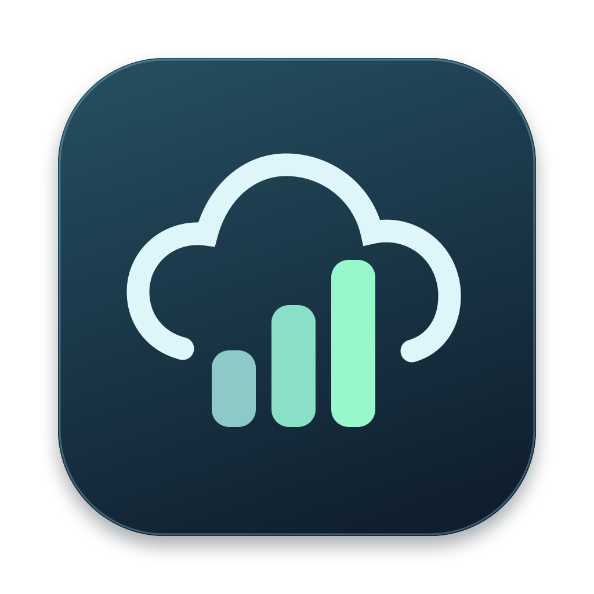
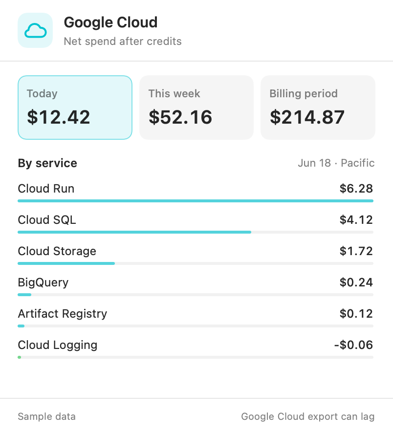

# GCP Billing Meter

**AI-generated documentation.**



See today's Google Cloud spend in your Mac menu bar. Click the meter for totals and a service breakdown for today, this week, and the current billing period.

**[Download the DMG](https://github.com/gclark-haven/gcp-billing-meter/releases/latest)** · macOS 14 or later · Apple silicon and Intel



## Install

1. Download the DMG from the latest release and open it.
2. Drag **GCP Billing Meter** to **Applications**, then open it.
3. Look for the cloud icon in the menu bar. Hold **⌘ Command** and drag the icon next to Ram Meter if you want the two meters together.

The app is ad hoc signed. If macOS blocks the downloaded app, follow [Apple's first-launch instructions](https://support.apple.com/en-us/102445). To build your own copy, see [Build from source](#build-from-source).

## Connect your billing data

1. [Install the Google Cloud CLI](https://docs.cloud.google.com/sdk/docs/install-sdk) with its included `bq` tool and run `gcloud auth login` in Terminal. Use the Google account that can read your billing export.
2. In Google Cloud, open **Billing → Billing export**. Enable **Standard usage cost** export if your billing account has no export yet. The app also accepts an existing **Detailed usage cost** export. Google may take several hours to populate a new export. [Billing export setup](https://docs.cloud.google.com/billing/docs/how-to/export-data-bigquery-setup)
3. In BigQuery, locate the usage cost table and note its dataset location. A full table name looks like `example-project.billing_export.gcp_billing_export_v1_XXXXXX_XXXXXX_XXXXXX`.
4. Click the menu bar meter and open **Settings**. Enter the full table name and location, such as `US`, `EU`, or `us-central1`. Leave the query project blank to run queries in the export's project, or choose a project where you can create BigQuery jobs. Click **Save** to load your billing data.

The active CLI account needs permission to read the export and run jobs in the query project. **BigQuery Data Viewer** on the dataset and **BigQuery Job User** on the query project are sufficient. The app sends its queries to BigQuery and displays the results on your Mac. BigQuery can charge for queries, which the app caps at 1 GiB of billed bytes per query. The meter queries at launch and about every 30 minutes while the app is running. You can refresh from the popover. Table identifiers and spend are personal settings and are never required in a GitHub issue.

## Read the totals

- **Today** uses usage from midnight Pacific time. **This week** uses usage from Monday through today, also in Pacific time.
- **Billing period** uses the current invoice month. It includes any applicable taxes, adjustments and late-posted items Google assigns to that period. This month's total can change until Google issues the invoice.
- Amounts include credits. When more than one currency is present, each currency has its own total.
- Services publish billing data on different schedules. The export timestamp tells you how fresh the source is. New usage can take more than 24 hours to appear. [Google Cloud billing export schema](https://docs.cloud.google.com/billing/docs/how-to/export-data-bigquery-tables/standard-usage)

## Open at login

In the meter’s options menu, select **Open at Login**. macOS also lists the app in **System Settings → General → Login Items & Extensions**.

## Build from source

Install Apple's Command Line Tools with `xcode-select --install`. From the repository directory, run:

```sh
mkdir -p "$HOME/Applications"
zsh build.sh "$HOME/Applications/GCP Billing Meter.app"
open "$HOME/Applications/GCP Billing Meter.app"
```

Choose a fresh absolute destination if the app is already at that path. To build both Apple silicon and Intel slices, prefix the build command with `GCP_BILLING_METER_UNIVERSAL=1`.

## Run the billing checks

```sh
mkdir -p .build
swiftc -swift-version 5 -parse-as-library Sources/BillingSource.swift Sources/BillingMeter.swift Tests/BillingChecks.swift -o .build/billing-checks
.build/billing-checks
```
